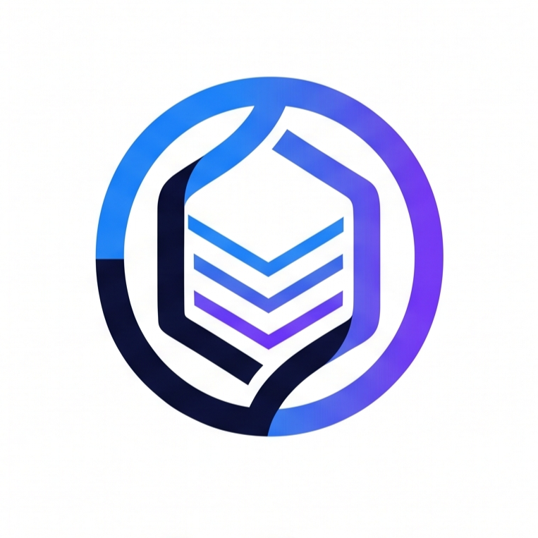

<p align="center">
  
</p>

<h1 align="center">OCERA</h1>

<p align="center">
  <strong>Optimized Concurrent & Crash-Resilient Database Engine</strong>
</p>

OCERA is a small educational embedded database engine built in C++ to demonstrate Operating Systems and DBMS concepts: page-based storage, buffering, indexing, transactions, locking, deadlock detection, logging, and crash recovery.

## Current status (2026-10-10)

**Month 1 storage foundation is integrated into `main`.** The storage and header tests have passed in the reported build.

**Implemented on feature branches, not yet integrated into `main`:**
- Bhavya: Transaction Manager and Lock Manager; tests passed on `feature/concurrency`.
- Ishika: SQL tokenizer; tests passed on `feature/indexing-sql`.

**Not yet implemented or verified:** Buffer Pool/LRU, B+Tree, full SQL parser/executor, verified deadlock cycle detection, WAL, checkpointing, crash recovery and full integration.

## Team ownership

| Teammate | Primary ownership | Main delivery window |
|---|---|---|
| Dhruv Prakash — team lead | Storage engine, Buffer Pool Manager/LRU, integration coordination | Month 1 storage (done); Buffer Pool in Month 2; ongoing integration |
| Ishika Singh | B+Tree/indexing, table/catalog and SQL front-end; WAL/recovery ownership pending team confirmation | Month 2 for indexing/SQL; Month 4 recovery owner to be confirmed |
| Bhavya Goel | Transaction Manager, Lock Manager, 2PL, deadlock detection and concurrency tests | Month 3 |

**Ownership and schedule are different:** a month describes the planned delivery/integration window, not exclusive ownership of everything listed in that month. For example, Dhruv owns the Buffer Pool even though its delivery is in Month 2.

## Roadmap

| Window | Planned work |
|---|---|
| Month 1 — complete | Page-based storage, DiskManager, free-space bitmap/allocation, database header, storage/header tests |
| Month 2 | Buffer Pool + LRU (Dhruv); B+Tree, records/tables, Catalog and SQL front-end foundation (Ishika) |
| Month 3 | Transaction lifecycle, locking/2PL, deadlock detection/recovery, concurrency tests (Bhavya) |
| Month 4 | WAL, checkpointing, crash recovery, full integration, benchmarks, documentation and demo (recovery owner pending team confirmation; shared integration) |

The team may work in parallel. Each module must use the shared contracts in `docs/api-contracts.md`, and any cross-module contract change must be reviewed before implementation diverges.

## Build and test

Requirements: C++17, CMake 3.15+, and a working threads library. Docker/Dev Containers are the recommended common environment; see [ONBOARDING.md](ONBOARDING.md).

From the repository root in a Linux shell/container:

```bash
mkdir -p build
cd build
cmake -G "Unix Makefiles" ..
cmake --build .
./ocera
./test_storage
./test_header
```

On Windows native builds, follow the MSYS2 instructions in [ONBOARDING.md](ONBOARDING.md). The Dev Container setup has recently been slow/stuck on Dhruv's machine; that is an environment issue to troubleshoot separately from the database implementation.

## Project layout

```
src/common/   shared page types and constants
src/storage/  DiskManager, FreeSpaceManager, DatabaseHeader; Buffer Pool planned
src/txn/      transaction and locking components planned
src/sql/      SQL, B+Tree, table/catalog components planned
tests/        module and integration tests
docs/         shared project status, interfaces and design decisions
```

## Shared team documents

- [Project brief and status](docs/project-brief.md)
- [Team roles](docs/team-roles.md)
- [API contracts](docs/api-contracts.md)
- [Architecture decisions](docs/architecture-decisions.md)
- [AI context](docs/ai-context.md)
- [Contribution/Git workflow](CONTRIBUTING.md)
